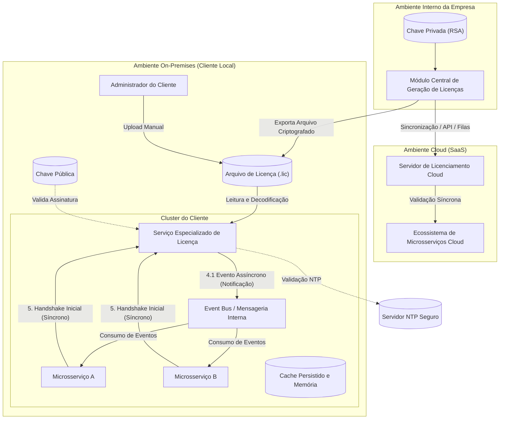
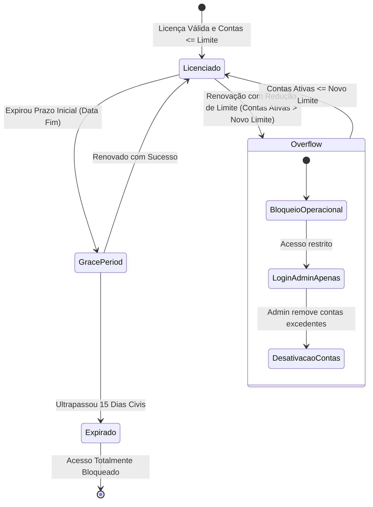

# Proposta de Arquitetura e Especificação Técnica: Sistema Global de Licenciamento

**Status:** Proposta em Draft
**Versão:** 1.0  

---

## 1. Resumo Executivo

Este documento apresenta a especificação técnica e funcional consolidada para o **Sistema Global de Licenciamento** da nossa família de produtos de software. 

O objetivo estratégico do projeto é fornecer um mecanismo robusto, seguro e altamente escalável para gerenciar a distribuição e a liberação de *features* (módulos e recursos) e o controle do volume de contas de usuários ativos contratados. O sistema oferece paridade total de regras e garantias de segurança tanto para clientes em **Nuvem (SaaS)** quanto para instalações **Locais (*On-Premises*)**.

### Principais Benefícios Estratégicos:
* **Monetização Granular:** Capacidade de comercializar produtos divididos em até 3 níveis de profundidade (Produto $\rightarrow$ Módulo $\rightarrow$ Recurso) com licenças totalmente independentes.
* **Flexibilidade Comercial:** Adoção de ciclos comerciais customizáveis (semanais, mensais, trimestrais, semestrais ou anuais), mantendo uma trava técnica de prazo máximo de **365 dias** para mitigar riscos operacionais e fraudes.
* **Governança do Limite de Usuários:** Garantia de conformidade contratual do número total de contas ativas, incluindo um mecanismo automático de bloqueio com acesso exclusivo para desativação administrativa em caso de redução de limite (*overflow*).
* **Segurança e Proteção de Ativos:** Criptografia assimétrica de ponta a ponta (RSA/JWS) para garantir que arquivos de licença não possam ser adulterados ou forjados nos ambientes dos clientes.

---

## 2. Visão Geral da Arquitetura de Software

A arquitetura foi projetada para suportar microsserviços com comunicação síncrona (APIs de baixa latência) e assíncrona (orientada a eventos via *Message Broker*), garantindo máxima resiliência, desacoplamento e isolamento de falhas.

### Componentes Principais da Solução:
1. **Módulo Central de Geração de Licenças (Empresa):** Módulo corporativo responsável por assinar e gerar pacotes criptografados usando a **Chave Privada** corporativa.
2. **Servidor de Licenciamento Cloud:** Atende os ambientes em nuvem via chamadas síncronas/assíncronas atualizadas em tempo real.
3. **Serviço Especializado de Licença (On-Premises):** Componente instalado no cliente local para validação de arquivos criptografados usando a **Chave Pública**, checagem de integridade e temporalidade via protocolo **NTP** e controle de permissões.

---

## 3. Requisitos Funcionais e Regras de Negócio

### 3.1. Hierarquia e Atribuição de Licenças
* **Hierarquia de 3 Níveis:** Suporte à estrutura `Produto` $\rightarrow$ `Módulo` $\rightarrow$ `Recurso`.
* **Independência Estrita:** Cada nó possui identificação única e licença individualizada. O licenciamento de um nó pai **não concede acesso automático** aos nós filhos (sem herança implícita).

### 3.2. Categorização Comercial e Empresas Parceiras
* **Categorias de Licença:** *Parceiro (Partner)*, *Teste (Test)*, *Temporária (Temporary)* e *Ordinária (Ordinary)*. As categorias estão totalmente disponíveis para relatórios de auditoria e consumo.
* **Empresas Parceiras:** Parceiros podem ser cadastrados e associados como representantes. Licenças selecionadas podem ser cedidas a parceiros a custo zero sem alterar a validade ou o teto de recursos. A gratuidade **não se estende** automaticamente aos clientes atendidos por esses parceiros.

### 3.3. Prazos, Validade e Período de Carência (*Grace Period*)
* **Ciclos Comerciais e Trava Máxima:** A equipe comercial pode negociar renovações em prazos semanais, quinzenais, mensais, trimestrais, semestrais ou anuais. O sistema **rejeita** qualquer emissão individual com prazo superior a **365 dias** para mitigar riscos de fraudes ou liberações perpétuas indevidas.
* **Período de Carência (15 dias):** Atingida a data de término contratual, o sistema concede automaticamente **15 dias civis** de tolerância para manter a operação sem interrupções enquanto a renovação financeira/contratual é finalizada. No 16º dia, o acesso é bloqueado.
* **Pré-requisitos de Aplicação:** Uma renovação só pode ser efetivada no sistema após a confirmação externa da negociação, assinatura do novo contrato e confirmação do pagamento.

### 3.4. Controle Global de Contas e Estado de Excesso (*Overflow*)
* **Teto por Contas Ativas:** O limite aplica-se ao total de contas de usuários ativas cadastradas no conjunto de produtos do cliente (e não por sessões simultâneas).
* **Bloqueio por *Overflow*:** Se um contrato renovado reduzir o limite máximo abaixo do número de contas atualmente ativas no ambiente do cliente, o sistema **bloqueia integralmente o uso operacional**.
* **Modo de Acesso de Correção:** Durante o *overflow*, apenas o perfil **Administrador** possui permissão de login, exclusivamente para desativar manualmente as contas excedentes e restabelecer a conformidade.

---

## 4. Diretrizes de Infraestrutura, DevOps e Segurança

### 4.1. Comunicação entre Microsserviços
* **Emissão e Atualização Assíncrona (4.1):** Quando um novo arquivo ou pacote de licença é importado/atualizado, o Serviço de Licença dispara um evento via *Message Bus* interno notificando imediatamente todos os demais microsserviços.
* **APIs de Consulta (4.2):** O Serviço de Licenças expõe endpoints síncronos (REST/gRPC) para verificações em tempo real e interfaces assíncronas para consultas em lote.

### 4.2. Diretriz de Inicialização de Serviços e Resiliência (DevOps)
* **Dependência Obrigatória na Subida (Item 5):** Ao ser inicializado, cada microsserviço realiza obrigatoriamente um *handshake* síncrono com o Serviço de Licença para carregar a matriz de permissões em memória (e em cache seguro persistido).
* **Política de Bloqueio em Subida:** Alinhado à estratégia corporativa de segurança, caso o Serviço de Licença esteja indisponível durante a inicialização, os demais microsserviços **não devem concluir a subida (fail-closed)**, evitando execuções em estado não auditado.

### 4.3. Criptografia e Proteção Contra Adulterações (*Clock Skew*)
* **Chaves Assimétricas:** A criptografia utiliza o par de chaves RSA. A chave privada permanece isolada no ambiente da empresa. A chave pública acompanha o executável local do cliente para validação de integridade.
* **Proteção de Temporalidade (NTP):** Para impedir alterações manuais do relógio do sistema local com o objetivo de estender artificialmente licenças ou períodos de carência, o Serviço de Licença local valida o horário utilizando conexões NTP seguras e validações internas de *timestamps* sequenciais.

---

## 5. Relatórios de Uso e Auditoria

O sistema consolida dados de telemetria e relatórios de uso em ambos os modos de implantação (*Cloud* e *On-Premises*), contendo:
* Identificação do Cliente e Empresa Parceira responsável (se houver).
* Produto, Módulo ou Recurso consumido.
* Conta do usuário ativo executante.
* Categoria da Licença utilizada (*Partner, Test, Temporary, Ordinary*).

---

## 6. Riscos, Premissas e Plano de Ação

| Item | Descrição / Risco | Mitigação / Decisão Proposta |
| :--- | :--- | :--- |
| **Integridade de Data (Local)** | Alteração manual do relógio no servidor do cliente para burla do prazo. | Validação do tempo via protocolo NTP e trava de *timestamp* histórico em disco. |
| **Disponibilidade On-Premises** | Dificuldade em atualizar arquivos de licença em clientes 100% desconectados da internet. | Portal do cliente para download manual do arquivo criptografado assinado pelo time comercial/suporte. |
| **Dependência do Serviço** | Microsserviços falharem ao subir se o serviço de licença estiver indisponível. | Mapeamento explícito na esteira de DevOps para priorização de subida do container/serviço de licença. |
| **Fraude Interna** | Geração indevida de licenças perpétuas por colaboradores. | Trava rígida no código do Módulo Gerador limitando o prazo máximo a 365 dias e auditoria central. |

---
