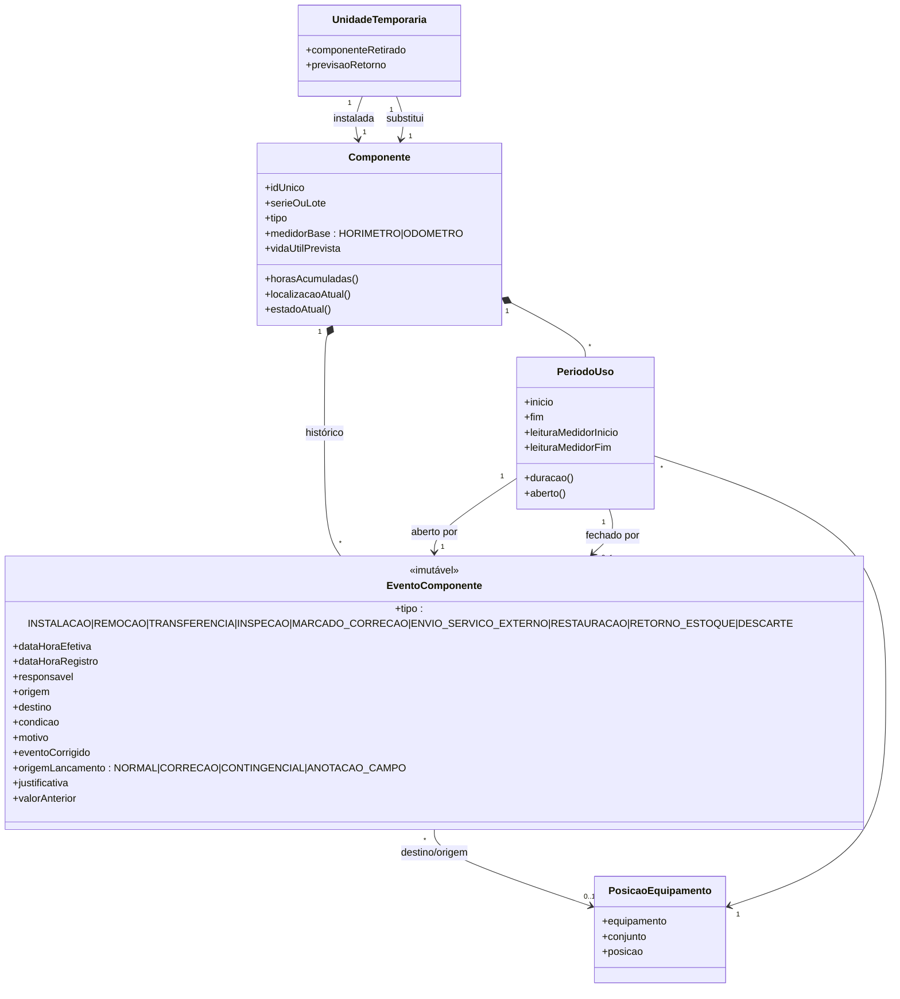

# Diagrama de classes — sugestão de modelo de domínio do CMMS

Proposta conceitual (não é modelo físico de banco). Baseada nos casos de uso [[00 - PT-Visão do fluxo e decisões pendentes|UC-00]] a [[06 - PT-Registro e ciclo de vida dos componentes|UC-06]] e nas decisões ali registradas. Fluxos relacionados em [[Mapa de fluxos do sistema]].

## Premissas de modelagem

- **OS = solicitação** (decisão 3): uma única classe `OrdemServico`, com os dados do relato do CCO. Ela agrupa várias `Tarefa`.
- **Configurável por mina** (decisões 1 e 4): prioridades, estados, transições e aprovações são dados (`Mina`, `DefinicaoFluxo`, `CriterioPrioridade`, `RegraAprovacao`), não código fixo.
- **Segurança fora do CMMS** (decisão 2): só existe a confirmação `localSeguroConfirmado` na OS/tarefa.
- **Histórico imutável**: estados, leituras e eventos de componente só acrescentam registros; correções criam novo registro.
- **Medida em horas** (decisão 8): as esperas e os tempos de trabalho são intervalos, e as durações são derivadas.
- **Componente com identificador único e horímetro próprio** (decisões 6 e 9); a vida útil se baseia em horímetro ou odômetro.
- **Estoque controlado pelo CMMS** (decisões 5 e 10): o CMMS é o consumidor do estoque. O ERP troca apenas informações comerciais/financeiras (custo de itens, pedidos), podendo expandir se o cliente pedir.
- **Custo da OS** (decisão 8): mão de obra (horas × valor-hora do `Profissional`) + material/equipamento (custo vindo do ERP).
- **Horímetro validado** (decisão 9): a leitura do relato é previsão; a real é validada na análise preliminar e é a usada nos períodos de uso.
- **Itens sem série** são consumíveis: só registro de uso e custo, sem `Componente`.
- **Relato offline** (decisão 7): aceito automaticamente em até 24 h; acima disso exige aceite manual. Documentos são anexados à OS e gravações entram como transcrição.
- **Reincidência** (decisão 8): mesmo fluxo de atendimento; a flag `reincidente` da tarefa é marcada manualmente, com sugestão do sistema.
- **Correção de componente** (decisão 9): o componente é marcado para correção e o serviço é feito por terceiro ou equipe especializada, fora do CMMS.
- **Grupos e permissões** (decisão 9): o cliente cria grupos de usuários e define, por grupo, o acesso a telas e recursos, inclusive às telas de correção e lançamento contingencial.
- **Localização**: a mina cadastra sua hierarquia de locais (geralmente Mina → Unidade Operacional → Level → Local), modelada de forma recursiva em `LocalTrabalho`.
- **Compatibilidade**: fica no cadastro do componente (`Item`), que lista os modelos de equipamento compatíveis (por exemplo, o componente A serve nos modelos md-1, md-2 e md-3).
- **Previsão de trocas e custo futuro** (UC-07, requisito central): `VidaUtilEsperada` (por item e modelo), `PerfilUso` (por equipamento) e `PeriodoUso` (horas já consumidas) geram `ProjecaoTroca`, valorada com o custo do ERP e as horas × valor-hora. Esses três cadastros devem existir desde a primeira versão, mesmo que a previsão venha depois.
- **Correção e lançamento contingencial** (decisão 9): telas especializadas de acesso restrito (permissão por grupo) para corrigir lançamentos, lançar contingencialmente ou digitar anotações de campo. O `origemLancamento` identifica o tipo, e `HistoricoEstado`/`EventoComponente` preservam o valor anterior.
- **Localização e compatibilidade** vêm de cadastros, como descrito acima.
- **ERP é a fonte da verdade** para custos e saldos recebidos; o CMMS só os usa em relatórios.

## 1. Visão geral (pacotes e relações principais)

```mermaid
classDiagram
    direction LR

    class Mina {
        +id
        +nome
        +grupo
    }
    class DefinicaoFluxo {
        +estados
        +transicoes
        +versao
    }
    class CriterioPrioridade {
        +nome
        +regra
        +prazoAlvoHoras
    }
    class RegraAprovacao {
        +gatilho
        +papelAprovador
        +obrigatoria
    }
    class Usuario {
        +id
        +nome
    }
    class GrupoUsuarios {
        +nome
    }
    class Permissao {
        +recurso : tela ou funcionalidade
        +acao : VER|CRIAR|EDITAR|CORRIGIR|APROVAR
    }
    class Profissional {
        +matricula
        +valorHora
        +origemValorHora : CADASTRO|SISTEMA_INTERNO
    }
    class Equipe

    class Equipamento {
        +id
        +tag
        +classe
    }
    class ModeloEquipamento {
        +codigo
        +fabricante
    }
    class LocalTrabalho {
        +nome
        +nivel : MINA|UNIDADE_OPERACIONAL|LEVEL|LOCAL
    }
    class LeituraMedidor {
        +tipo : HORIMETRO|ODOMETRO
        +valor
        +dataHora
        +situacao : PREVISTA|VALIDADA
    }

    class OrdemServico {
        +numero
        +estado
        +custoMaoDeObra()
        +custoMaterial()
        +custoTotal()
        +horasEspera()
        +horasIndisponibilidade()
        +canalContato
        +origemRegistro : ONLINE|OFFLINE
        +dataHoraGeracao
        +aceiteManualOffline
        +dataHoraContato
        +dataHoraRegistro
        +descricaoFalha
        +justificativaPrioridade
        +localSeguroConfirmado
        +disponibilidadeTecnicaEm
        +recebimentoCCOEm
        +encerradaEm
    }
    class Tarefa {
        +descricao
        +estado
        +reincidente : boolean
        +horasEstimadas
        +criterioConclusao
    }
    class Apontamento {
        +inicio
        +fim
        +horas
        +valorHoraAplicado
        +custo()
    }
    class Evidencia
    class Anexo {
        +nome
        +tipo : DOCUMENTO|TRANSCRICAO
    }    class TesteInspecao {
        +resultado
        +obrigatorio
    }
    class Aprovacao {
        +decisao
        +justificativa
        +dataHora
    }
    class HistoricoEstado {
        +estadoAnterior
        +estadoNovo
        +justificativa
        +dataHora
    }
    class Espera {
        +motivo
        +inicio
        +fim
    }

    class Item {
        +codigo
        +tipo : COMPONENTE_RASTREAVEL|CONSUMIVEL
        +custoUnitarioERP
    }
    class VidaUtilEsperada {
        +medidor : HORIMETRO|ODOMETRO
        +intervaloTroca
        +horasMaoDeObraTroca
        +paralisacaoEstimadaHoras
    }
    class PerfilUso {
        +horasPorDiaProjetadas
        +metodo : MEDIA_90_DIAS|PLANO_MINA|SAZONAL
        +atualizadoEm
    }
    class ProjecaoTroca {
        +dataPrevista
        +horasRestantes
        +custoMaterial
        +custoMaoDeObra
        +origem : CALCULADA|AJUSTE_MANUAL
        +confianca
        +vencida
    }
    class LocalEstoque
    class SaldoEstoque
    class ReservaMaterial
    class SolicitacaoMaterial {
        +quantidade
        +refPedidoERP
        +previsaoEntrega
    }
    class ConsumoMaterial {
        +quantidade
        +custoApropriado
    }
    class IntegracaoERP {
        +ultimaSincronizacao
    }

    class Componente {
        +idUnico
        +serieOuLote
        +medidorBase
        +horasAcumuladas
        +estadoAtual
    }
    class EventoComponente {
        +tipo
        +dataHoraEfetiva
        +motivo
        +condicao
    }
    class PeriodoUso {
        +leituraInicial
        +leituraFinal
        +duracao
    }

    Mina "1" --> "1" DefinicaoFluxo
    Mina "1" --> "*" CriterioPrioridade
    Mina "1" --> "*" RegraAprovacao
    Mina "1" --> "*" Equipamento
    Mina "1" --> "*" GrupoUsuarios
    GrupoUsuarios "*" --> "*" Usuario
    GrupoUsuarios "1" --> "*" Permissao
    Mina "1" --> "*" LocalTrabalho : hierarquia configurável
    LocalTrabalho "1" --> "*" LocalTrabalho : contém
    Equipamento "*" --> "1" ModeloEquipamento
    Equipamento "*" --> "0..1" LocalTrabalho : local atual
    OrdemServico "*" --> "0..1" LocalTrabalho : local da falha
    Item "*" --> "*" ModeloEquipamento : compatível com
    Item "1" --> "*" VidaUtilEsperada : por modelo
    VidaUtilEsperada "*" --> "1" ModeloEquipamento
    Equipamento "1" --> "1" PerfilUso
    Componente "1" --> "*" ProjecaoTroca
    ProjecaoTroca "*" --> "1" Equipamento
    ProjecaoTroca ..> PerfilUso : usa
    ProjecaoTroca ..> VidaUtilEsperada : usa
    ProjecaoTroca ..> PeriodoUso : horas já consumidas
    Mina "1" --> "*" LocalEstoque
    Equipamento "1" --> "*" LeituraMedidor

    OrdemServico "*" --> "1" Equipamento
    OrdemServico "*" --> "1" CriterioPrioridade
    OrdemServico "1" *-- "*" Tarefa
    OrdemServico "1" *-- "*" HistoricoEstado
    OrdemServico "1" *-- "*" Espera
    OrdemServico "1" *-- "*" Aprovacao
    OrdemServico "1" *-- "*" Anexo
    OrdemServico "1" o-- "*" TesteInspecao
    OrdemServico "*" --> "0..1" OrdemServico : relacionada a
    Tarefa "1" *-- "*" Apontamento
    Tarefa "1" *-- "*" Evidencia
    Apontamento "*" --> "1" Profissional
    Profissional --|> Usuario
    Tarefa "*" --> "0..1" Equipe
    Tarefa "*" --> "0..1" Profissional : responsável

    Item "1" --> "*" SaldoEstoque
    LocalEstoque "1" --> "*" SaldoEstoque
    Tarefa "1" --> "*" ReservaMaterial
    Tarefa "1" --> "*" SolicitacaoMaterial
    Tarefa "1" --> "*" ConsumoMaterial
    ReservaMaterial "*" --> "1" SaldoEstoque
    ConsumoMaterial "*" --> "1" Item
    IntegracaoERP ..> Item : custo unitário
    IntegracaoERP ..> SolicitacaoMaterial : pedido de compra
    OrdemServico "1" --> "*" ConsumoMaterial : custo de material
    OrdemServico "1" ..> "*" Apontamento : custo de mão de obra

    Componente "*" --> "1" Item : tipo (rastreável)
    Componente "1" *-- "*" EventoComponente
    Componente "1" *-- "*" PeriodoUso
    EventoComponente "*" --> "0..1" Equipamento
    EventoComponente "*" --> "0..1" OrdemServico
    EventoComponente "*" --> "0..1" Tarefa
    PeriodoUso "*" --> "1" Equipamento
    PeriodoUso ..> LeituraMedidor : calculado por
```

## 2. Detalhe do núcleo de componentes (UC-06)



Regras associadas:

- Uma remoção fecha o `PeriodoUso`; uma reinstalação abre um novo. Os períodos anteriores permanecem.
- `localizacaoAtual()` e `estadoAtual()` são derivados do último evento. Nada é sobrescrito, e correções referenciam o evento corrigido.
- `horasAcumuladas()` soma as durações dos períodos de uso, pelo medidor do equipamento em cada período.

## 3. Pontos de atenção

| Ponto | Sugestão | Dependência |
|---|---|---|
| Estoque e ERP | O CMMS controla saldo, reserva e rotatividade. Valores e saldos vindos do ERP são a verdade; o CMMS não gere custo externo e os usa só para relatórios. | Decisões 5, 8 e 10 |
| Previsão de trocas e custo | Requisito central (UC-07). Registrar vida útil esperada, perfil de uso e custo de reposição desde o início. Pontos a definir: método de projeção de uso, valor de reposição, tratamento de vencidos. Entrega da previsão: fase posterior (cadastros de base desde a primeira versão). A camada de orçamento (aprovação, versões, cenários) vem depois, sobre `ProjecaoTroca`. | UC-07 |
| Custos | Custo da OS = horas × valor-hora + material (custo do ERP). Orçamento aprovado, forecast e variação ainda não têm classes; entrariam como extensão no modelo financeiro de [[Análise documental e matriz de rastreabilidade]]. | Decisão 8 |
| Datas retroativas, itens sem série e correção | Horímetro validado na análise preliminar; consumíveis sem série só têm uso e custo. Componente que precisa de correção é marcado, e o serviço é externo, fora do controle do CMMS (só envio e retorno são registrados). Hierarquia de locais e compatibilidade por modelo são cadastros. Falta pesquisar o algoritmo de sugestão de reincidência. | Decisão 9 |
| Reincidência | Marcação manual em `Tarefa.reincidente`; o sistema só sugere. | Decisão 8 |
| Configuração | `DefinicaoFluxo` e `RegraAprovacao` devem ser versionadas para não alterar OS já abertas. | Decisões 1 e 4 |
| Integração ERP | Entrada: custo de itens e pedidos. Saída opcional: baixa de estoque. | Decisões 5, 8 e 10 |
