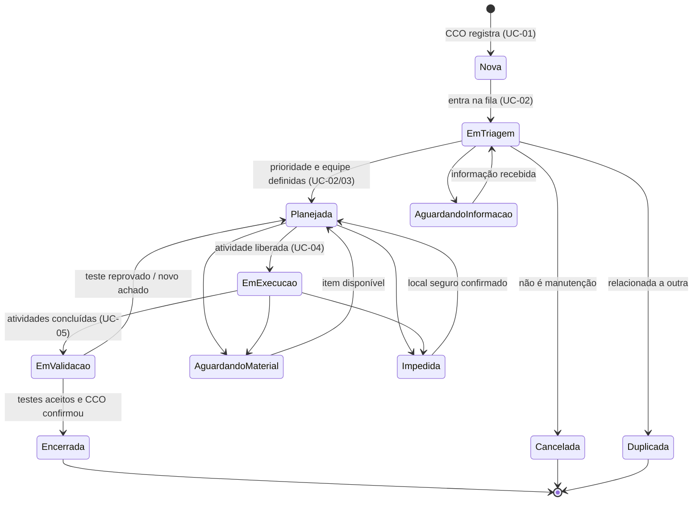
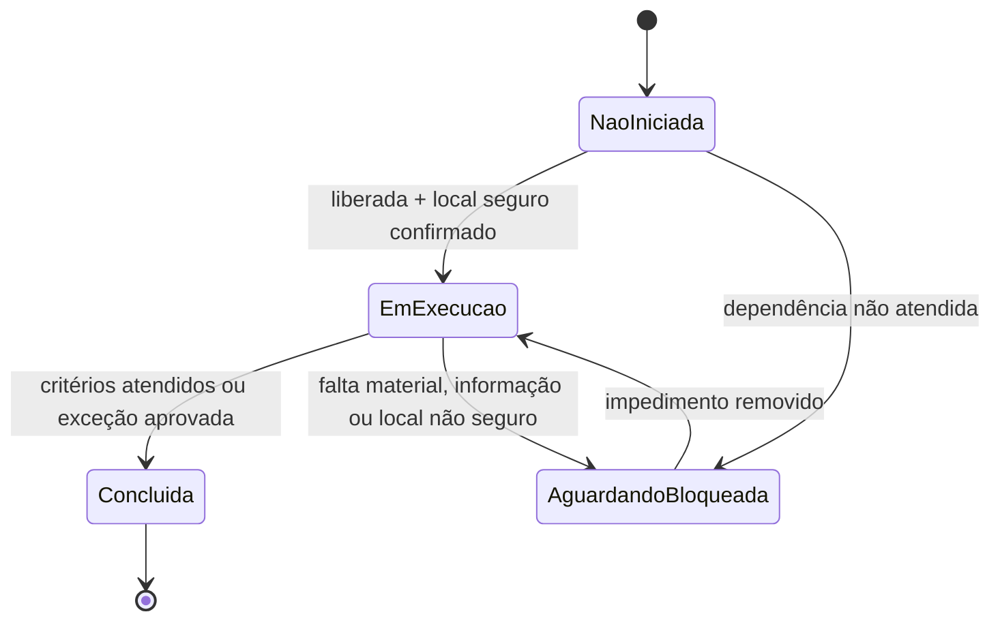
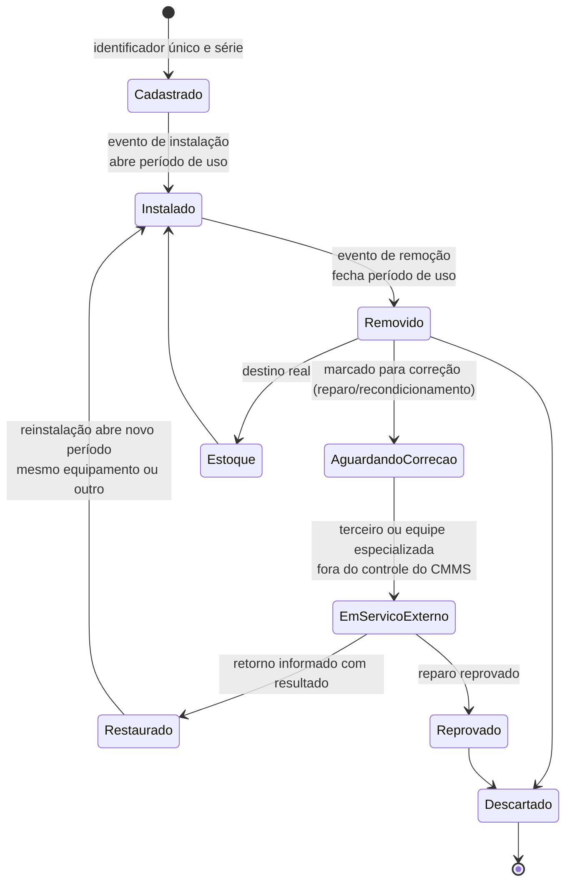

# Mapa de fluxos do sistema — CMMS

Derivado dos casos de uso [[00 - PT-Visão do fluxo e decisões pendentes|UC-00]] a [[07 - PT-Previsão de troca de componentes e custo futuro|UC-07]], já com as decisões do negócio registradas no UC-00: solicitação = OS com várias tarefas; segurança fora do CMMS; priorização e aprovações configuráveis por mina; CMMS solicita materiais e controla estoque/reserva, e o ERP trata compras; entrada manual dos relatos; métricas em horas. Os estados são o conjunto padrão sugerido e podem ser configurados por mina.

## 1. Fluxo ponta a ponta

```mermaid
flowchart TD
    classDef uc fill:#e8f1fb,stroke:#2f6fb3,color:#000
    classDef ext fill:#f3f3f3,stroke:#888,color:#000
    classDef wait fill:#fff4d6,stroke:#c28a00,color:#000
    classDef gap fill:#fff,stroke:#b33,stroke-dasharray:5 5,color:#b33

    OP([Operador em campo]):::ext
    CCO([CCO]):::ext
    EMG[/Procedimento de emergência<br/>fora do CMMS/]:::ext

    subgraph UC01[UC-01 · Registro do relato]
        A1[Operador relata falha<br/>por rádio ou mensagem embarcada]:::uc
        A2[CCO coleta dados e orienta segurança]:::uc
        A3[CCO registra manualmente no CMMS<br/>gera OS com ID único<br/>anexos; gravações transcritas<br/>offline: sincroniza em até 24 h]:::uc
        A3B[Tela restrita: correção, lançamento<br/>contingencial ou de anotações de campo]:::uc
        A4{Já existe solicitação<br/>aberta para a mesma falha?}
    end

    subgraph UC02[UC-02 · Triagem]
        B1[Revisar relato, riscos e evidências]:::uc
        B2{Dados suficientes<br/>e é demanda de manutenção?}
        B3[Classificar prioridade pelos critérios<br/>configurados da mina]:::uc
        B4[Atribuir equipe e responsável<br/>marcar reincidente manualmente<br/>(sistema só sugere); notificar]:::uc
    end

    subgraph UC03[UC-03 · Avaliação e planejamento]
        C1[Confirmar equipamento em<br/>local seguro para manutenção]:::uc
        C2[Inspecionar: diagnóstico, validar<br/>horímetro/odômetro real, componentes]:::uc
        C3[Definir escopo e tarefas da OS<br/>responsável, horas, critério]:::uc
        C4[Materiais e peças: consultar estoque<br/>controlado pelo CMMS, reservar ou solicitar]:::uc
        C5{Todos os itens<br/>disponíveis?}
        C6[Liberar tarefas<br/>conforme aprovações configuradas]:::uc
    end

    subgraph UC04[UC-04 · Execução]
        D1[Confirmar equipamento<br/>e local seguro]:::uc
        D2[Iniciar tarefa<br/>registrar horas, evidências, materiais]:::uc
        D3[[Eventos de componente:<br/>instalação, remoção, reinstalação]]:::uc
        D4{Defeito adicional<br/>ou impedimento?}
        D5[Concluir atividade<br/>critérios atendidos]:::uc
        D6{Há atividades<br/>pendentes?}
    end

    subgraph UC05[UC-05 · Validação e retorno]
        E1[Revisar escopo, componentes<br/>e pendências]:::uc
        E2[Executar e registrar testes<br/>e inspeções pós-intervenção]:::uc
        E3{Testes aprovados<br/>e sem defeito impeditivo?}
        E4[Comunicar disponibilidade técnica ao CCO]:::uc
        E5{CCO confirmou recebimento<br/>ou exceção formal?}
        E6[Encerrar solicitação]:::uc
    end

    subgraph UC06[UC-06 · Ciclo de vida dos componentes]
        F1[(Histórico imutável de eventos<br/>por componente)]:::uc
        F2[Visão atual: local e estado<br/>derivada dos eventos]:::uc
        F3[Períodos de uso e<br/>duração acumulada]:::uc
    end

    subgraph EXT[Sistemas e processos externos]
        ERP[(ERP<br/>custos e pedidos de compra,<br/>baixa de estoque opcional)]:::ext
        SEG[/Procedimentos de segurança da mina/]:::ext
        RH[(Cadastro de profissionais<br/>valor-hora)]:::ext
    end

    subgraph UC07[UC-07 · Previsão de trocas e custo futuro]
        H1[Vida útil restante do componente<br/>vida esperada − uso acumulado]:::uc
        H2[Projeção de uso do equipamento<br/>horas por dia]:::uc
        H3[Data prevista da troca<br/>horas restantes ÷ uso diário]:::uc
        H4[Valorar: material ERP + horas × valor-hora<br/>consolidar por trimestre e ano]:::uc
        H5[Previsão de rotables<br/>e planejamento do orçamento]:::uc
    end

    subgraph FIN[Custo da OS · horas + material]
        G1[Mão de obra = horas × valor-hora<br/>Material = custo do ERP × quantidade<br/>ERP é a fonte da verdade; só relatórios]:::uc
        G2[Orçamento aprovado, versões e variação<br/>camada futura sobre a previsão]:::gap
    end

    OP --> A1 --> A2
    A2 -. risco iminente .-> EMG
    A2 --> A3 --> A4
    A4 -- sim --> A5[Relacionar ao registro existente]:::uc --> B1
    A4 -- não --> B1
    B1 --> B2
    B2 -- não --> W1[Aguardando informação<br/>ou Cancelada/Duplicada]:::wait
    W1 -. informação recebida .-> B1
    B2 -- sim --> B3 --> B4 --> C1
    C1 --> C2 --> C3 --> C4 --> C5
    C5 -- sim --> C6
    C5 -- não ou parcial --> W2[Aguardando material<br/>tarefas afetadas bloqueadas]:::wait
    C5 -- parcial: liberar o que não depende do item --> C6
    C4 -. solicitação de compra .-> ERP
    ERP -. pedido e previsão de entrega .-> W2
    W2 -. item recebido .-> C6
    C1 -. local não seguro .-> W3[Impedida<br/>local não seguro]:::wait
    W3 -. acionar segurança da mina .-> SEG
    W3 -. local seguro confirmado .-> C1
    C6 --> D1 --> D2 --> D3 --> D4
    D4 -- sim --> C3
    D4 -- impedimento --> W2
    D4 -- não --> D5 --> D6
    D6 -- sim --> D1
    D6 -- não --> E1 --> E2 --> E3
    E3 -- não --> C2
    E3 -- sim --> E4 --> E5
    E5 -- não --> E4
    E5 -- sim --> E6
    E6 --> CCO
    CCO -. libera retorno à operação .-> OP

    C4 -. unidade temporária<br/>previsão de retorno .-> F1
    D3 --> F1
    A3B -. corrige ou complementa .-> D2
    A3B -. eventos lançados depois .-> F1
    E1 -. confere movimentos .-> F1
    F1 --> F2
    F1 --> F3

    D2 --> G1
    E6 --> G1
    G1 -.-> G2
    ERP -. custo do material .-> G1
    RH -. valor-hora .-> G1
    ERP -. custo do material .-> C4

    F3 --> H1
    H1 --> H3
    H2 --> H3
    F2 -. leituras validadas .-> H2
    H3 --> H4
    ERP -. custo de reposição .-> H4
    RH -. valor-hora .-> H4
    H4 --> H5
    H5 -.-> G2
    D3 -. troca real reinicia a vida e recalcula .-> H1
```

Leitura do diagrama:

- Linhas contínuas são o fluxo principal; tracejadas são exceções, esperas, integrações e lacunas.
- O CMMS controla o estoque, não faz compras nem gere segurança. O ERP troca informações comerciais/financeiras: custo do material e pedidos.
- O custo da OS = horas × valor-hora (cadastro de profissionais) + custo do material. A previsão de trocas e custo futuro (UC-07) usa o uso acumulado dos componentes e a projeção de uso dos equipamentos. Orçamento aprovado, versões e variação são a camada futura sobre essa previsão.
- Um teste reprovado (UC-05) volta para a inspeção (UC-03). O trabalho anterior permanece no histórico.
- Encerrar a OS, disponibilidade técnica e liberação operacional são três coisas distintas. A última é decisão da operação, fora do CMMS.
- Custos não constam nos casos de uso; ver o mapeamento financeiro em [[Análise documental e matriz de rastreabilidade]].

## 2. Estados da OS (conjunto padrão configurável)



As esperas exigem motivo e responsável pela próxima ação, e o tempo em cada estado é medido em horas (métrica da mina). Estados, transições e aprovações são configuráveis por mina; o diagrama mostra o padrão sugerido.

## 3. Estados da tarefa



O estado da OS é independente do estado das tarefas. Uma OS pode ter tarefas concluídas e outras bloqueadas.

## 4. Ciclo de vida do componente (UC-06)



Os nomes de estado são ilustrativos; o UC-06 diz que a lista definitiva depende de validação com a mina. O estado e a localização atuais são derivados dos eventos, e nenhum evento é apagado. Cada componente tem um identificador único e um horímetro próprio, e o período de uso é medido nele (decisões 6 e 9).

## 5. Mapa de fluxos × casos de uso

| Fluxo | UC-01 | UC-02 | UC-03 | UC-04 | UC-05 | UC-06 | UC-07 |
|---|:-:|:-:|:-:|:-:|:-:|:-:|:-:|
| Relato manual pelo CCO | ● | | | | | | |
| Prioridade, atribuição e fila | | ● | | | | | |
| Confirmação de local seguro e liberação de tarefas | | | ● | ● | ○ | | |
| Materiais: consulta de estoque, reserva e solicitação | | | ● | ● | | ○ | ○ |
| Horas, evidências e apontamentos | | | ○ | ● | ○ | | |
| Eventos de componente | | | ○ | ● | ○ | ● | |
| Testes, comunicação ao CCO e encerramento | | | | | ● | | |
| Histórico e trilha de auditoria | ○ | ○ | ○ | ○ | ○ | ● | |
| Custo da OS (horas × valor-hora + material) | | | ○ | ● | ○ | | ○ |
| Previsão de trocas e custo futuro por uso | | | | ○ | | ○ | ● |
| Orçamento aprovado, versões e variação | | | | | | | — |

● principal · ○ participa · — camada futura, ainda sem caso de uso (ver a seção financeira da matriz).
