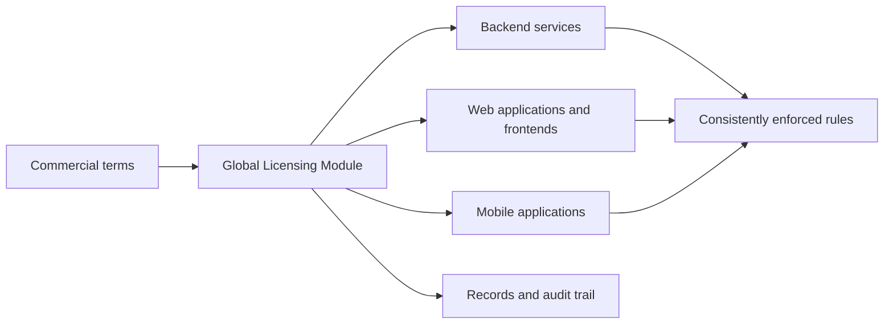
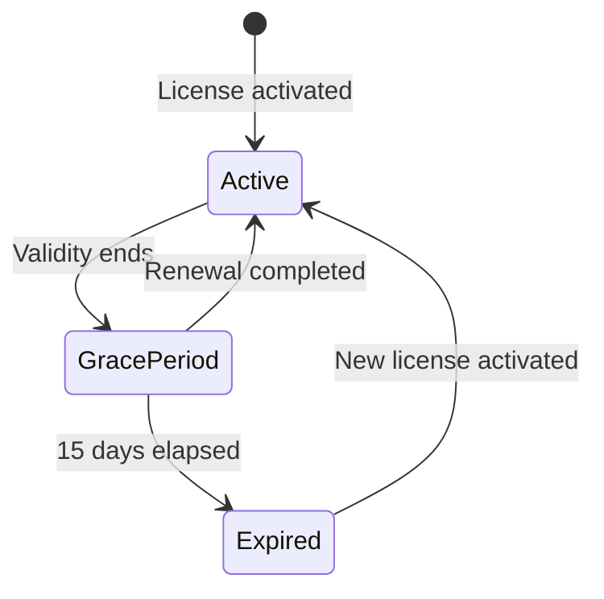
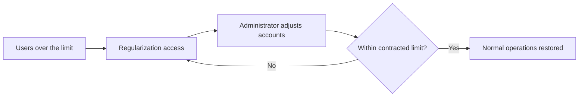
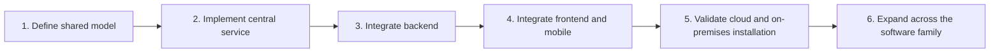
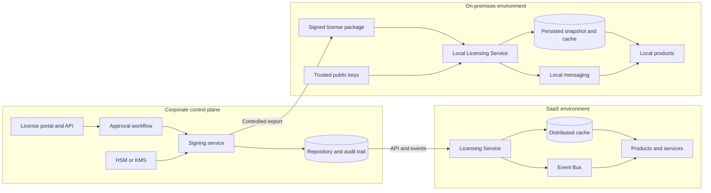

# Global Licensing System

## Executive proposal for the Lumi Mining software family

**Status:** Proposal  
**Version:** 1.2  
**Date:** October 18, 2026  
**Target audience:** Executive Management, Product, Sales, Operations, Security, and Technology

---

## 1. Executive summary

Lumi Mining is developing the first version of its software family. The Global Licensing System will be a core module of this platform, used from the outset by all its components: backend services, web applications, frontends, and mobile applications.

The module will control which products, modules, and features each customer may use, for how long, and for how many users. The same set of rules will serve solutions operated in the cloud and solutions installed on the customer's infrastructure.

### Decision requested

Approve the development of the global licensing module as a shared capability of the Lumi Mining software family, with phased deployment and progressive validation across the backend, frontend, and mobile.

### Recommendation

Proceed with the initiative, prioritizing:

- a consistent experience across all channels;
- security in license issuance and enforcement;
- continuity of customer operations;
- flexibility in creating commercial offerings;
- clear responsibilities across Sales, Product, Operations, and Technology.

---

## 2. Initiative context and purpose

Licensing should be established as part of the software family's initial architecture, not as a solution created later to correct differences between existing products.

The goal is to create a central module that can be used by:

- backend services and APIs;
- web applications and other frontends;
- mobile applications;
- products operated in the cloud;
- products installed on the customer's infrastructure.

This module will establish a single way to define and enforce product usage rules, including available features, license validity, user counts, and commercial terms.

### Expected outcomes

- Make licensing part of the foundation of the new software family.
- Prevent each application from creating its own incompatible controls.
- Ensure a consistent experience across the backend, frontend, and mobile.
- Make it easier to create new products, modules, and features.
- Apply commercial terms consistently across all channels.
- Reduce rework and maintenance costs as the portfolio evolves.
- Provide a shared foundation for security, control, and auditing.

---

## 3. Benefits for Lumi Mining

### Business

- **Commercial flexibility:** products, modules, and features can be offered separately.
- **Revenue protection:** actual usage will align with what was purchased.
- **Scalability:** new services can adopt the module without creating their own licensing system.
- **Portfolio evolution:** new offerings can reuse the same rules and integrations.

### Product and experience

- **Consistency across channels:** an authorization granted to a customer will be interpreted in the same way by the backend, frontend, and mobile.
- **Predictable experience:** validity, renewal, and limits will behave consistently.
- **Lower risk of divergence:** the interface will not expose a feature that the backend must reject, or vice versa.

### Operations

- **Traceability:** issuances, renewals, changes, and cancellations will be recorded.
- **Governance:** exceptions will require approval and justification.
- **Lower complexity:** all components will use the same module and rules.

---

## 4. Solution overview

The licensing module will act as the central source of authorization. Each component will use this source according to its responsibility:

- the **backend** will protect data, operations, and APIs;
- the **frontend** will present only the features available to the customer;
- **mobile** will apply the same permissions, including in limited-connectivity scenarios;
- components will share the same product, module, feature, and customer identifiers.

> Hiding a feature in the frontend or mobile does not replace backend validation. The backend will be the final authority for protected operations.

---

## 5. What will be controlled

The module will control:

- purchased products;
- available modules;
- enabled features;
- maximum number of active users;
- license start and end dates;
- grace period after expiration;
- license category and purpose;
- associated customer, environment, and partner company;
- suspension or cancellation;
- history of key decisions and changes.

---

## 6. Offering structure

Commercial items may be organized into up to three levels:

Each item will have its own identifier and can be controlled individually.

Purchasing a product will not automatically unlock all modules and features. Permitted combinations will be defined in the software family's catalogue.

### Example

A customer may purchase:

- Operations Management product;
- Planning module;
- Advanced Reporting feature;
- global limit of 500 active users.

The backend will authorize the corresponding operations, while the frontend and mobile will provide the experience appropriate to the same license.

---

## 7. License types

| Type | Purpose | Main guideline |
|---|---|---|
| Commercial | Regular customer use | Associated with a contract, validity period, and defined limits |
| Partner | Internal use by a partner company | Does not automatically authorize use by the customers it serves |
| Trial | Evaluation or acceptance testing | Shorter duration and non-production use |
| Temporary | Exceptional need | Requires justification, approval, and an end date |

---

## 8. Validity and renewal

### Proposed rules

- Each license will have a start and end date.
- Each individual issuance will have a maximum duration of 365 days.
- After expiration, the customer will have 15 calendar days to complete regularization.
- Operations will continue during this period, and alerts will be displayed.
- From the 16th day onward, use of licensed features will be blocked unless renewal has been completed.
- Renewal will take effect after confirmation of the commercial and contractual process.
- Exceptions will require formal approval and an audit record.

---

## 9. User-count control

The limit will apply to the total number of active human accounts for the customer across the products covered by the contract.

The same person should not be counted multiple times for using different applications in the family. To achieve this, the backend, frontend, and mobile applications must use a shared customer identity.

Service accounts and integrations will be handled under a specific rule and may not be used to circumvent the commercial limit.

### Customer over the limit

When the number of active users exceeds the purchased amount:

- normal use will be temporarily restricted;
- authorized administrators will be able to access the regularization area;
- excess accounts can be reviewed and deactivated;
- users cannot be created or reactivated;
- normal operations will automatically resume after regularization.

---

## 10. Use by the backend, frontend, and mobile

### Backend

- It will be the final authority for allowing or denying operations.
- It will validate licenses before executing protected actions.
- It will not rely exclusively on information sent by the frontend or mobile.
- It will record relevant decisions for auditing.

### Web frontend

- It will query permissions to build menus, pages, and actions.
- It will not display features unavailable to the customer.
- It will present clear messages about expiration, regularization, and limits.
- It will handle license changes without requiring a new application version.

### Mobile applications

- They will apply the same rules as the other channels.
- When needed, they will keep a temporary, protected copy of the latest valid permissions.
- They will have defined behavior for offline operation or limited connectivity.
- They will synchronize changes as soon as connectivity is restored.
- They may not expand permissions based solely on local data.

---

## 11. Cloud operation and on-premises installations

### Cloud

Licenses and changes will be distributed automatically to the software family's services.

### On-premises installation

The license may be provided as a protected file imported by the customer's administrator. Operation will not depend on a permanent connection to Lumi Mining.

Where possible, an integration may be provided to simplify updates, while a controlled process will remain available for environments without internet access.

---

## 12. Security and revenue protection

The solution must prevent a license from being created, changed, or reused without authorization.

The main controls will be:

- protection of credentials used for issuance;
- separation between the person requesting and the person approving;
- maximum duration for each issuance;
- recording of issuances and changes;
- cancellation of licenses issued in error or through fraud;
- protection against using a license belonging to another customer or environment;
- protection against reuse of older versions;
- date verification in on-premises installations;
- mandatory backend validation of protected operations.

Technical implementation controls are detailed in the technical appendix to this specification.

---

## 13. Operational continuity

The licensing module must not become a single point of failure for the software family.

During temporary failures, components may use the last valid authorization received for a limited period. After the defined safety period, access may be restricted until validation is restored.

For mobile and on-premises installations, the use of stored permissions must account for:

- a maximum local validity period;
- protection against tampering;
- identification of the customer and, where applicable, the device or environment;
- synchronization after connectivity is restored;
- inability to expand permissions locally.

---

## 14. Auditing and privacy

The data necessary for control and auditing will be recorded:

- customer and associated partner;
- licensed products and features;
- category and validity;
- user limit;
- issuances, renewals, suspensions, and cancellations;
- regularization situations;
- relevant administrative decisions.

Collection must be limited to the information necessary. For on-premises installations and mobile, data transmission, retention, and access must comply with applicable contractual and privacy requirements.

---

## 15. Risks and proposed responses

| Risk | Possible impact | Proposed response |
|---|---|---|
| Different rules across channels | Inconsistent experience and authorization failures | Shared model and identifiers across backend, frontend, and mobile |
| Validation only in the interface | Unauthorized access through direct API calls | Backend as the final authority |
| Licensing module unavailable | Interruption of the software family | Last valid authorization for a controlled period |
| Mobile or installation without internet | Difficulty validating changes | Protected, temporary permissions with subsequent synchronization |
| Local date changed | Use beyond the contracted period | Combined checks and anomaly recording |
| Improper issuance | Revenue loss or fraud | Separation of request and approval, limits, and auditing |
| Incorrect user count | Improper blocking or revenue loss | Shared identity, deduplication, and reconciliation |
| Excessive data collection | Privacy risk | Data minimization, defined retention, and controlled access |

---

## 16. Proposed deployment

### Phase 1: rules and shared model

- define the catalogue and identifiers;
- define license types;
- define validity, renewal, and exceptions;
- define active users and service accounts;
- define responsibilities across teams;
- define the shared contract used by the different channels.

### Phase 2: central service

- create registration, issuance, approval, and auditing capabilities;
- integrate commercial terms and identity;
- implement security and operational monitoring.

### Phase 3: backend integration

- protect APIs and operations;
- implement permission lookup and temporary permission storage;
- standardize authorization and denial reasons.

### Phase 4: frontend and mobile integration

- provide a shared library or consumption contract;
- standardize menus, messages, and states;
- validate mobile operation with limited connectivity.

### Phase 5: environment validation

- test cloud operation;
- test on-premises installation without a continuous connection;
- validate renewal, expiration, excess users, and failure recovery.

### Phase 6: expansion

- include new services as the family evolves;
- monitor indicators and incidents;
- maintain compatibility between module versions and application versions.

---

## 17. Decisions required

| Topic | Proposed decision |
|---|---|
| Module role | A central, shared capability of the software family |
| Supported channels | Backend, web frontend, and mobile applications |
| Security authority | Backend as the final authority for protected operations |
| Commercial model | Products, modules, and features controlled separately |
| Validity | Maximum of 365 days per issuance |
| Regularization | 15 calendar days after expiration |
| Users | Global limit on active human accounts per customer |
| Connectivity | Support cloud, mobile with limited connectivity, and on-premises installations |
| Exceptions | Require justification, approval, and auditing |
| Data | Collect only what is necessary and comply with contractual and privacy requirements |

---

## 18. Success criteria

The initiative will be considered successful when:

- the backend, frontend, and mobile use the same licensing model;
- the backend prevents operations without valid authorization;
- interfaces correctly reflect the purchased features;
- new services can integrate the module without creating their own controls;
- rules behave consistently in the cloud and in on-premises installations;
- mobile operation is predictable with limited connectivity;
- user counting is reliable and explainable;
- issuances and changes have an audit history;
- the platform can evolve without breaking applications that use previous contract versions.

---

## 19. Technical appendix: architecture, security, and operations

This appendix complements the executive guidelines with the technical requirements needed to implement licensing. The control plane governs and issues licenses; the data plane validates authorizations with the products. The architecture must support SaaS and on-premises installations without requiring permanent connectivity to Lumi Mining.

### 19.1 Scope

**Included:**

- registration of customers, partners, and environments;
- catalogue of Products, Modules, and Features;
- creation, approval, issuance, renewal, suspension, and revocation of licenses;
- distribution to SaaS and on-premises installations;
- feature-level access validation and global control of active human accounts;
- grace, overflow, and expiration states;
- auditing of issuance, import, changes, and relevant usage.

**Initially out of scope:** billing and payments, full contract management, management of customers' corporate identities, and advanced commercial analytics. These domains remain in specialized systems; licensing will consume events or authorized confirmations from those platforms.

### 19.2 Reference architecture

| Layer | Components | Responsibility |
|---|---|---|
| Control plane | Portal, API, approval, HSM/KMS, repository, and audit trail | Register, approve, sign, version, distribute, and revoke licenses |
| SaaS | Licensing Service, cache, messaging, and SDK | Validate entitlements with low latency and propagate changes |
| On-premises installation | Local service, persisted cache, public keys, and local audit | Import and validate licenses without continuous internet access |
| Integrations | Contracts, CRM/ERP, billing, IAM, and observability | Provide authorized events and receive only permitted data |

### 19.3 Issuance and distribution

1. The commercial or contractual process generates an authenticated request.
2. An authorized user requests issuance and another user approves it, according to separation-of-duties requirements.
3. The system creates a canonical payload, assigns versions, and signs the license with a private key protected by HSM/KMS.
4. In SaaS, changes are distributed through events and APIs.
5. For on-premises installations, the customer's administrator imports a signed `.lic` package.
6. The service validates the signature, customer, tenant, environment, version, validity, and prerequisites.
7. Products consume a versioned local view; updates invalidate incompatible or outdated caches.

### 19.4 Content and cryptographic protection

JWS will be mandatory for authenticity and integrity. An RSA signature alone does not encrypt or make content confidential. JWE will be used only when there is a formal confidentiality requirement.

Each license must contain, at a minimum:

- issuer, customer, and tenant;
- authorized environment;
- entitlements and limits;
- validity start and end in UTC;
- policy and license versions;
- unique `jti` identifier and key `kid` identifier.

The private key will remain in an HSM or KMS. Issuance must enforce RBAC and separation of duties. Key rotation must support multiple trusted public keys during the transition and include procedures for key retirement or compromise. Licenses must be protected against replay and version downgrade.

### 19.5 Trusted time and availability

In on-premises installations, validation must not depend exclusively on NTP. It must combine UTC, NTS or authenticated NTP when available, a monotonic clock, the last persisted trusted timestamp, defined clock-skew tolerance, clock rollback detection, and detection of restoration from old snapshots or backups.

At startup, a handshake with the Licensing Service will be the preferred path. If the service is unavailable, a signed and previously validated snapshot may be used within a technical lease of up to 24 hours, subject to operational approval. After the lease expires, validation will fail closed. The same principle of temporary, protected permissions applies to mobile and other offline scenarios: cache does not expand permissions, and changes are synchronized when connectivity returns.

Revocation takes precedence over grace periods, cache, and validity. For disconnected customers, revocation will be applied at the next connection, with shorter deadlines defined for higher-risk categories and a controlled manual distribution process where necessary.

### 19.6 States and behavior

| State | Condition | Behavior |
|---|---|---|
| Active | License is valid and accounts are within the limit | Normal operation |
| Grace period | License has expired, is within the 15-day period, and has not been revoked | Operations continue with alerts; policies may prevent new activations |
| Overflow | Active human accounts exceed the contracted limit | Remediation actions only |
| Suspended | Authorized administrative suspension | Blocking according to policy, with the reason recorded |
| Revoked | Explicit revocation | Priority blocking and cache invalidation as soon as possible |
| Expired | Grace period has ended | Licensed use is blocked; support and remediation may remain available |

A renewal creates a new license version, activated after an authorized event from the contractual and financial process. Exceptions require formal approval and an audit record.

### 19.7 Identity, limits, and remediation

An active account is a human identity enabled to authenticate and use products within the same tenant. Counting must use an authoritative identity source, deduplicate the same person across products using a tenant-wide identifier, and periodically reconcile discrepancies. Technical and service accounts follow a separate policy; they are excluded from the human limit only when classified, authorized, and audited.

In overflow, in addition to the regularization actions described in section 9, the system will allow authorized administrators with MFA to sign in, review the license and audit trail, correct and deactivate accounts, and perform essential synchronization with the identity provider. Functional use, account creation or reactivation, and operations unrelated to remediation will be blocked. Normal operation will resume automatically once the count is within the limit.

### 19.8 Auditing and privacy

The audit trail must be append-only and record requests, approvals, issuance, renewal, suspension, revocation, local import, policy or limit changes, grace and overflow transitions, signature or trusted-time failures, and administrative remediation actions.

In SaaS, telemetry will integrate with corporate observability. For on-premises installations, local auditing is mandatory; export to Lumi Mining will be configurable according to the contract. Identifiers will be pseudonymized where possible, and retention, residency, purpose, and access will be defined with Legal and Compliance.

### 19.9 Risks and technical controls

| Risk | Control |
|---|---|
| Licensing service unavailable | Signed snapshot with limited lease, high availability, health checks, and chaos testing |
| Clock tampering | Combined trusted time sources and rollback detection |
| Improper issuance or key compromise | Maker-checker, RBAC, HSM/KMS, rotation, incident response, and auditing |
| Disconnected customer | Signed manual package and controlled operational procedure |
| Inconsistent counting | Authoritative source, deduplication, and reconciliation |
| Excessive telemetry | Data minimization, defined retention, and configurable export |
| Ambiguous prerequisites between Product, Module, and Feature | Explicit, versioned dependencies validated atomically |

### 19.10 Deliverables to start development

1. Domain model and versioned rules.
2. Initial API and event contracts.
3. Threat model and architectural decisions.
4. Interoperable prototype of a JWS license signed with a key in HSM/KMS.
